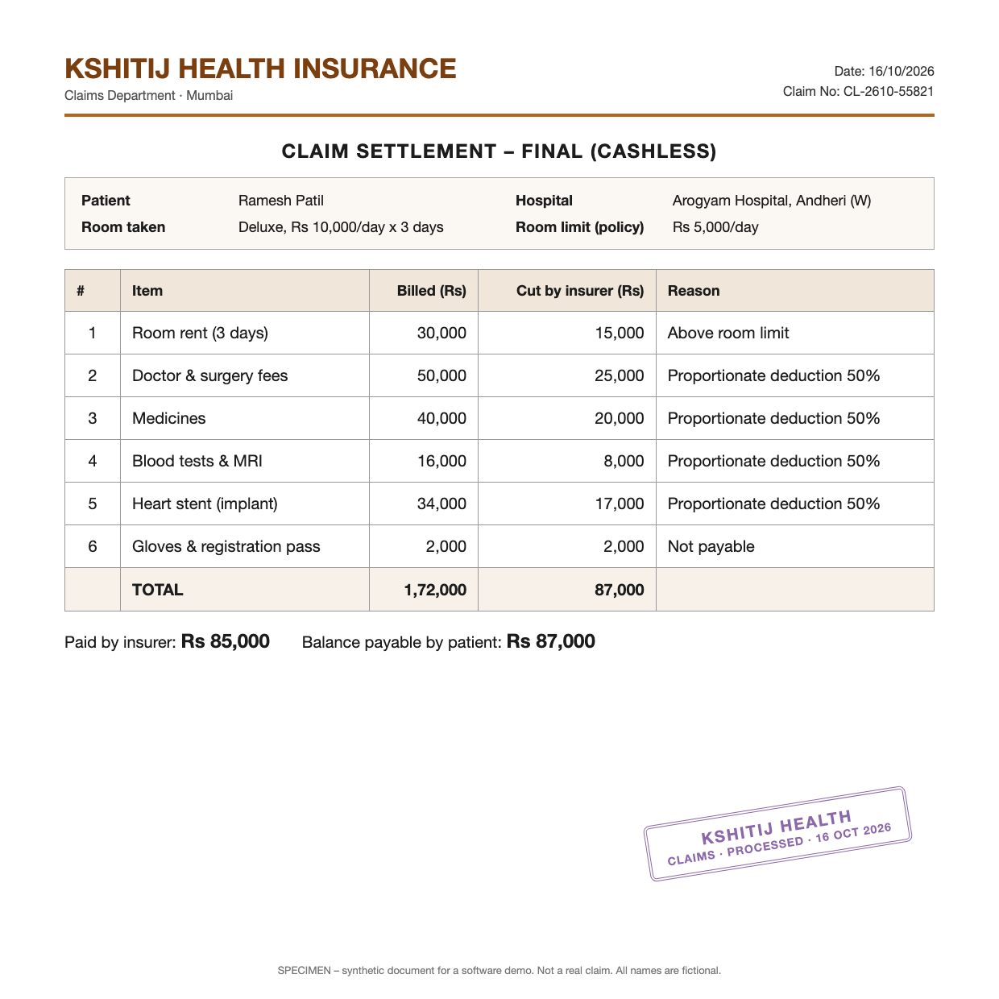
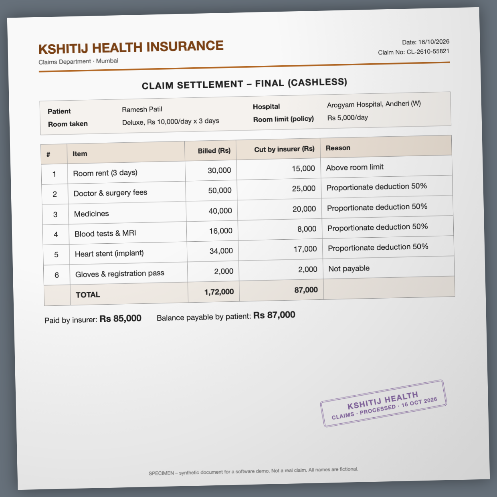
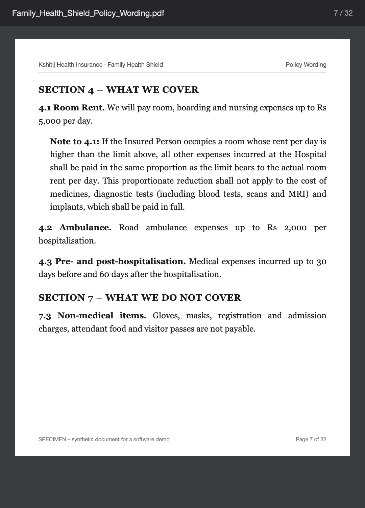
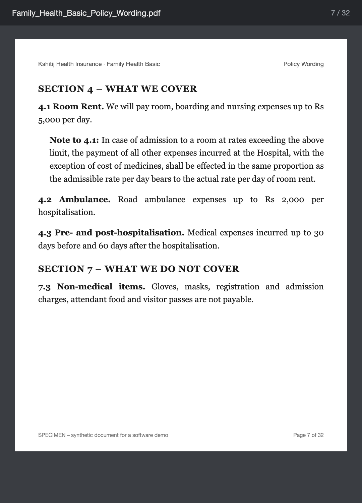
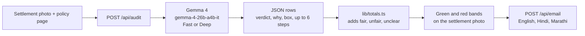

<h1 align="center">FairClaim — The Money They Cut. Back.</h1>

<p align="center">
  <em>An open-weight, multimodal hospital-claim checker powered by <strong>Google Gemma 4 (<code>gemma-4-26b-a4b-it</code>)</strong>. It reads the insurer's settlement and one page of the policy, and marks the room-rent cuts that page does not allow.</em>
</p>

<p align="center">
  <a href="https://ai.google.dev/gemma/docs/core"></a>
  <a href="LICENSE"></a>
  
  <a href="#quickstart"></a>
  <a href="CONTRIBUTING.md"></a>
</p>

<p align="center">
  <a href="#the-problem">The problem</a>
  ·
  <a href="#walkthrough">Walkthrough</a>
  ·
  <a href="#why-gemma-4">Why Gemma 4</a>
  ·
  <a href="#architecture">Architecture</a>
  ·
  <a href="#quickstart">Quickstart</a>
</p>

There is no logo file in this repo. The screen title is the words above: **FairClaim**. The tagline on the page is **The money they cut. Back.**

Gemma reads the two photos. Code adds up the rupees (`lib/totals.ts`). The model never supplies the total on screen.

## <a id="the-problem"></a>🚨 The Problem

A cashless bill is often settled while the patient is still in the hospital. The demo papers in this repo are **synthetic**. The footer on each image says so. Names, the hospital, and the claim number are made up. The pattern on the bill is the one the app is built to show.

The specimen is a ₹5,000-a-day room cap. The room taken is a deluxe room at ₹10,000 a day for 3 days. The insurer cuts associated lines by half, and cuts the whole of a small non-payable line. The patient is asked for **₹87,000**.

On the first policy page, **₹45,000** of that cut is on medicines, blood tests and MRI, and a heart stent. Those three lines are the ones the screen calls unfair. The other **₹42,000** (room rent above the cap, doctor and surgery fees, gloves and the registration pass) is marked fair. The same bill with the stricter policy page comes to **₹20,000** unfair, because that page leaves out only medicines.

This is not a claim that every rupee cut in India is illegal. The circular below says what an insurer may not put inside "associate medical expenses". The uploaded page is what FairClaim scores.

### The rule on the page

[IRDAI circular IRDAI/HLT/REG/CIR/151/06/2020](https://irdai.gov.in/en/document-detail?documentId=394680) (11 June 2020) is about proportionate deduction when someone takes a higher room than the policy allows. The insurer has to define "associate medical expenses" in the contract. Paragraph 4 of that circular says these costs **cannot** be part of that definition:

- cost of pharmacy and consumables
- cost of implants and medical devices
- cost of diagnostics

Doctor fees can still be reduced in the same proportion when the policy says so and the hospital bills them by room category. ICU charges are not to be proportionately deducted. A hospital that does not bill differently by room should not have the deduction applied.

The demo policies are both headed **Section 4.1 Room Rent**. That clause number is on the specimen page. It is not the paragraph number of the circular.

| | First page (`public/demo/policy.png`) | Stricter page (`public/demo/policy-b.png`) |
| --- | --- | --- |
| Room cap | ₹5,000 a day | ₹5,000 a day |
| What the cut does not touch | Medicines, diagnostic tests (blood tests, scans, MRI), and implants, paid in full | Only the cost of medicines |
| Unfair total on this bill | ₹45,000 | ₹20,000 |

Gloves, masks, registration charges, and visitor passes are listed as not payable on both pages (Section 7.3). On this bill that line is a fair cut of ₹2,000.

### Public numbers, each with its year

These are industry figures. They are not measurements of FairClaim.

| Figure | What was counted | Source |
| --- | --- | --- |
| **₹18,521 crore disallowed** | In FY 2024-25, general and standalone health insurers disallowed this much "as per terms and conditions of policy contract". Outright repudiations were **₹11,412 crore**. Disallowance covers cuts such as room-rent limits, co-payments, and sub-limits. It is not a count of room-rent cuts alone. | [IRDAI Annual Report 2024-25](https://irdai.gov.in/web/guest/annual-reports), Table I.29. Posted on IRDAI's site on 30 Dec 2025. This is the latest annual report listed there as of Oct 2026. |
| **79% of ombudsman decisions** | In FY 2025-26, Insurance Ombudsmen decided **41,055** grievances. IRDAI said **79%** were in favour of policyholders. That is every kind of insurance complaint, not only hospital deductions. | [The Hindu, 21 May 2026](https://www.thehindu.com/business/insurance-ombudsmen-decided-41055-grievances-in-fy26-79-in-favour-of-policyholders/article71007671.ece), quoting IRDAI. |
| **66.35% of claim amount paid cashless** | In FY 2024-25, **66.35%** of the health claim *amount* was paid cashless. About **58%** of claims *by number* were cashless. Cashless is the hospital-desk path. IRDAI's timeline for final discharge authorisation is **three hours**. | IRDAI Annual Report 2024-25, Table I.28. [The Economic Times](https://economictimes.indiatimes.com/industry/banking/finance/insure/record-health-insurance-claims-settled-in-fy25-average-payout-per-claim-declines/articleshow/126339512.cms) reported the 66.35% figure. An Economic Times piece on [20 Oct 2026](https://economictimes.indiatimes.com/industry/healthcare/biotech/healthcare/healthrail-turning-indias-hospital-receivables-into-growth-capital/articleshow/135069045.cms) rounded the same IRDAI figure to about 66%. |

## <a id="walkthrough"></a>📸 Visual product walkthrough

The repo has the papers the demo loads. It does not have a screenshot of the running screen, and it does not have a logo. The pictures below are the inputs. The words under them are the words the screen uses.

**Load demo case** fetches `public/demo/settlement.png` and `public/demo/policy.png`. The policy switcher then swaps in `public/demo/policy-b.png`. `public/demo/settlement-messy.png` is the same bill, skewed like a phone photo. The demo button does not load it. You can upload it yourself.

### Settlement table

<p align="center">
  
</p>

Claim `CL-2610-55821`. Room taken: deluxe, ₹10,000 a day for 3 days. Policy room limit: ₹5,000 a day. Billed ₹1,72,000. Cut by the insurer ₹87,000. Paid by the insurer ₹85,000. Balance asked from the patient ₹87,000.

<p align="center">
  
</p>

### The two policy pages

<p align="center">
  
  
</p>

Left: medicines, diagnostic tests, and implants stay paid in full. Right: only medicines are excepted. Gemma is scored against the page you upload. The two buttons on the result are:

- **Standard Policy (Meds, Tests & Stents Exempt) · ₹45,000 back**
- **Stricter Policy (Only Meds Exempt) · ₹20,000 back**

### What the result screen says

On the first policy the heading is **₹45,000 was cut unfairly**. Under it: **Insurer cut ₹87,000 · fair ₹42,000 · unfair ₹45,000**.

The lists are titled **Fair cuts** and **Unfair, challenge these**. Fair rows are green. Unfair rows are red. Hover or click a row and the settlement photo highlights that band. The band comes from the `box` Gemma returns: `[y1, x1, y2, x2]` on a 0 to 1000 grid.

| Item | Cut | First policy |
| --- | ---: | --- |
| Room rent (3 days) | ₹15,000 | Fair |
| Doctor & surgery fees | ₹25,000 | Fair |
| Gloves & registration pass | ₹2,000 | Fair |
| Medicines | ₹20,000 | Unfair |
| Blood tests & MRI | ₹8,000 | Unfair |
| Heart stent (implant) | ₹17,000 | Unfair |

Those six rows and both totals are locked in `fixtures/golden.json` and `fixtures/golden-b.json`. A stricter-policy test expects unfair **₹20,000**.

### Steps and the letter

While a check is running, the page shows four progress lines (reading the table, reading Section 4.1, checking each 50% cut, then the totals). After the answer arrives, **How Gemma decided** lists the steps Gemma returned. The schema allows at most six. The recorded demo answer has these six:

1. Read the policy to find the room rent limit and rules for over-limit room costs.
2. Identify the patient and claim details from the settlement table.
3. Compare each item in the settlement table with the policy rules.
4. Check if the room rent cut is correct based on the limit.
5. Verify if the proportionate reduction was applied to items that should be paid in full.
6. Determine if the cuts to medicines, tests, and implants were fair or unfair based on the policy.

**Deep** mode can also show Gemma's thought text and a reasoning-token count. **Fast** mode uses minimal thinking.

**Write complaint email** calls `POST /api/email` and drafts a letter to the Grievance Redressal Officer. The tabs are **English**, **हिंदी**, and **मराठी**. Copy, or Print / Save PDF. If a number in the letter is not one of the audit amounts, the screen says **Check the amounts before sending.** That check is `lib/numbers.ts`. The letter needs a working `GEMINI_API_KEY`. The demo verdict can still appear from the recorded answer if the live audit call fails.

## <a id="why-gemma-4"></a>🧠 Why Google Gemma 4

The model id in `app/api/audit/route.ts` and `lib/gemma.ts` is `gemma-4-26b-a4b-it`. Temperature is 0. The reply is JSON, checked against `prompts/schema.json`. Fast sets thinking to minimal. Deep sets thinking to high and asks for the thoughts.

Gemma 4 is an open-weight model family under Apache-2.0. This repository does **not** run a local weight such as `gemma-4-e4b`, and it does not call Ollama. A live check sends the two images to Google's Gemini API for that request. FairClaim does not write the photos to disk. See `SECURITY.md`.

| | FairClaim on Gemma 4 | A closed model API (ChatGPT, Claude, and the like) |
| --- | --- | --- |
| Weights | Open weights, Apache-2.0. This app calls `gemma-4-26b-a4b-it` on the Gemini API. | The vendor keeps the weights. |
| The photos | Not saved by this app. A live check sends them to Google for that request. **Load demo case** can fall back to the recorded synthetic answer. | The photos go to that vendor. |
| The page | Each row comes back with a box on a 0–1000 grid. The screen paints green and red bands from those boxes. Totals are added in `lib/totals.ts`. | The model call does not, by itself, paint the page or add the rupees. |
| Fast and deep | **Fast** and **Deep** are on the page. Deep can show the thought text. | Depends on that product. |
| The letter | English, Hindi, and Marathi, from the audit JSON. Amounts in the letter are checked in code. | Depends on that product. |

## <a id="architecture"></a>🏗️ System architecture



`POST /api/audit` takes multipart form fields `settlement` (file), `policy` (file), `mode` (`fast` or `deep`, default `fast`), and `demo` (`1` or `strict`, only from the demo buttons). It returns `{ model, mode, source, ms, usage, thinking, audit, totals }` or `{ error }`. `source` is `live` or `replay`. `totals` is always recomputed from `audit.rows`.

`POST /api/email` takes JSON `{ audit, totals, language }` where `language` is `Hindi` or `Marathi`. It returns `{ subject, english, local, guardOk }`.

Photos must be JPEG, PNG, or WebP, up to 8 MB. The browser also accepts those types and shrinks a large photo to a JPEG whose long side is at most 1600 px before upload.

## <a id="quickstart"></a>🚀 Quickstart, local setup, and DigitalOcean

Needs Node.js 20 or newer (this copy was run on Node.js 26) and npm.

```bash
git clone https://github.com/Dhruv-Patil-1720/FairClaim.git
cd FairClaim
npm install
cp .env.example .env.local
```

Put your key in `.env.local`:

```
GEMINI_API_KEY=your_key_here
```

```bash
npm run dev
```

Open [http://localhost:3000](http://localhost:3000). Click **Load demo case**. Then click **Stricter Policy (Only Meds Exempt)**.

There is no Dockerfile. Production mode:

```bash
npm run build
npm start
```

`next start` listens on `PORT` when that variable is set, and on port 3000 otherwise. It binds `0.0.0.0`.

With the dev server running, the demo audit is:

```bash
curl -s \
  -F settlement=@public/demo/settlement.png \
  -F policy=@public/demo/policy.png \
  -F mode=fast \
  -F demo=1 \
  http://localhost:3000/api/audit | head -c 800
```

Set `FORCE_REPLAY=1` in `.env.local` if you want that demo call to skip Gemma and use the recorded JSON immediately.

```bash
npm run test
npm run lint
```

### DigitalOcean App Platform

The spec is `.do/app.yaml`. The button spec is `.do/deploy.template.yaml`.

[](https://cloud.digitalocean.com/apps/new?repo=https://github.com/Dhruv-Patil-1720/FairClaim/tree/main)

Same settings if you create the app by hand:

1. App Platform, create an app from GitHub `Dhruv-Patil-1720/FairClaim`, branch `main`.
2. Web service, Node.js buildpack. No Dockerfile.
3. Build command: `npm run build`
4. Run command: `npm start`
5. HTTP port **8080**. Set `PORT` to `8080` so `next start` listens there.
6. Secret environment variable: `GEMINI_API_KEY`. Do not put the key in the repo.

The spec asks for the smallest App Platform size (`apps-s-1vcpu-0.5gb`). Change that in the DigitalOcean UI if the build runs out of memory.

## What it will not do

- It is not legal advice. It does not file a complaint, and it does not replace the policy, a lawyer, or the insurer's process. You decide what to send.
- It does not know your sum insured. The specimen pages do not state one.
- A live letter can be wrong. Read it. Send it only if the amounts match the bill.
- Hindi and Marathi are drafted by the model. Have a reader check them before you send them.

## Honesty note

The idea, prompt drafts, JSON schema and synthetic demo papers were prepared the day before the event. All application code was written during MLH Hacktoberfest Hack Day Mumbai on 24 Oct 2026.

## Contributing

See [CONTRIBUTING.md](CONTRIBUTING.md). Security reports go through [SECURITY.md](SECURITY.md), not a public issue. Behaviour for people in the repo is in [CODE_OF_CONDUCT.md](CODE_OF_CONDUCT.md).

## License

[Apache License 2.0](LICENSE). Copyright 2026 Dhruv Unmesh Patil.

Gemma 4 is an open-weights model under the Apache License 2.0. That notice is also in the footer of the app.
